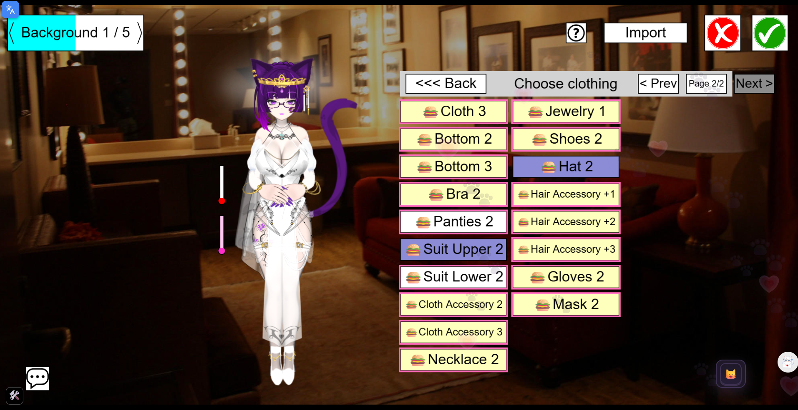
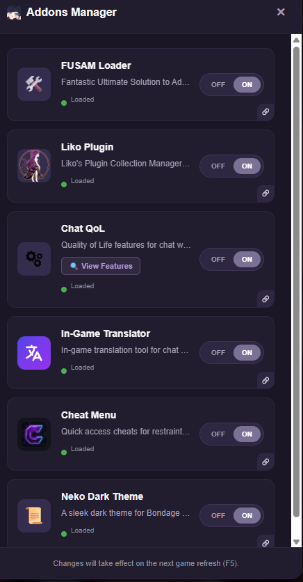

<div align="center">
  
  <h1>BC Desktop</h1>
  <p>Lightweight, native desktop client for BC</p>

  <p>
    <a href="https://github.com/Izumii99/BC-Desktop/releases"></a>
    <a href="https://github.com/Izumii99/BC-Desktop/releases"></a>
  </p>
  <p>
    
    
    
    
  </p>
</div>

---

A minimal native desktop wrapper for BC, built with **WPF** and **.NET 8**. Uses the OS native webview (Edge WebView2 no bundled Chromium) keeping the RAM footprint and CPU usage as small as possible.

## Features

- **Auto-detects the latest game version** on every launch
- **OTA (Over-the-Air) Built-in Remote Loader**: Addon manager and remote scripts are seamlessly embedded into the executable and fetched automatically on startup
- **Silent Release Checker**: Background check for newer desktop releases with unobtrusive title bar notifications
- **Borderless custom title bar** with seamless drag, minimize, maximize, and close
- **Immersive Fullscreen (F11)** and **Chromium DevTools (F12)** keyboard shortcuts
- **Sleeping Tabs (Suspend on minimize)** to drastically reduce RAM while in background
- **Multi-monitor support** with proper DPI scaling bounds
- **Discreet / Stealth** design for Task Manager and Taskbar

## Adding Custom / Local Scripts Manually

You can load your own custom scripts or community mods offline without using Tampermonkey or bookmarklets by placing them in a local `Scripts/` directory.

### Folder Structure

Place the `Scripts` folder in the same root directory as the executable:

```text
📁 BC-Desktop/
├── 📁 Scripts/
│   ├── my-custom-addon.js
│   └── another-mod.js
└── BC.exe (or BC-Windows.exe / BC-Linux.AppImage)
```


## Included Scripts / Addons

This repository also hosts standalone scripts in the `Scripts/` folder. You can use them directly via Tampermonkey or Bookmarklets even without the Desktop App:

### 1. Neko Dark Mode (`neko-dark.js`)

A custom dark mode theme designed specifically for **Neko Chat Enhancer**.


**Design Highlights:**

- **Deep Purple Aesthetic:** Replaces the default harsh black/white with a sleek, unified dark purple palette that feels premium and is much easier on the eyes.
- **Refined Background Overlay:** The floating heart (love) particles in the background are tweaked with custom opacity and blend modes, giving a subtle and beautiful half-screen ambiance without distracting from the chat.
- **Improved Readability:** Action texts, whispers, and chat borders have been re-colored to stand out elegantly against the dark background.

> [!TIP]
> **Built-in Auto-Loader (No Manual Installation Required):**  
> Powered by [QAQMOON/meow-](https://github.com/QAQMOON/meow-). **Sudah auto-include di aplikasi, tidak perlu install manual!** (*Auto-included out-of-the-box — no separate installation needed.*) When enabled via the Addon Manager, the theme automatically loads and applies the dark aesthetic without extra steps.

**How to Install:**

#### Bookmarklet (One-Click)

```javascript
javascript: (function () {
    var script = document.createElement("script");
    script.src =
        "https://cdn.jsdelivr.net/gh/Izumii99/BC-Desktop@main/Scripts/neko-dark.js?v=" +
        Date.now();
    document.head.appendChild(script);
    console.log("Fetching Neko Dark from GitHub...");
})();
```

#### Tampermonkey, ViolentMonkey, etc. (Auto-Loader)

```javascript
// ==UserScript==
// @name         Neko Addons (Auto-Loader)
// @namespace    http://tampermonkey.net/
// @version      1.0
// @description  Neko Chat Enhancer dark mode
// @author       Izumii99
// @match        https://*.bondageprojects.elementfx.com/*
// @match        https://*.bondage-europe.com/*
// @match        https://*.bondageprojects.com/*
// @match        https://*.bondage-asia.com/*
// @grant        none
// ==/UserScript==

(function () {
    "use strict";
    var script = document.createElement("script");
    script.src =
        "https://cdn.jsdelivr.net/gh/Izumii99/BC-Desktop@main/Scripts/neko-dark.js?v=" +
        Date.now();
    document.head.appendChild(script);
    console.log("Neko Addons Loader: Injected successfully!");
})();
```

### 2. Wardrobe & Appearance Pagination (`wardrobe-pagination.js`)

> [!NOTE]
> **OFFICIALLY MERGED INTO BCX!**
> This script was originally created as a standalone mod to fix the wardrobe overflow issue. We are incredibly proud to announce that the underlying logic has now been **natively integrated into the official [Bondage Club Extended (BCX)](https://github.com/Jomshir98/bondage-club-extended) repository!**
>
> You no longer need to install this script if you are using the latest version of BCX. The pagination is now a core feature! 🎉

Fixes the issue where having too many clothing items (e.g. from using multiple mods) causes the item list to overflow beyond the right side of the screen, making them impossible to click.

<p float="left">
  
  
</p>

_The standalone script has been officially retired as the pagination feature is now part of native BCX._

### 3. Chat QoL & Emoticons (`chat-qol.js`)

A massive quality-of-life upgrade for the chat system that seamlessly translates text emoticons into actual 3D character facial expressions, and more.


> [!NOTE]
> **FEATURES MIGRATED TO BC-LCE!**
> Some features originally developed as part of this script (such as the **Petsuit/Animal Animations** and Alternate Arm Swings) have now been officially merged into the **[BC-LCE (Liko's Chat Enhancer)](https://github.com/awdrrawd/BC-LCE)** repository for better integration! 
> If you are looking for those specific features, please install the latest version of BC-LCE.

**Features:**

- **Text-to-Expression Emoticons:** Typing text like `:)`, `>:(`, `;p`, `><`, `=///=` or even `>3<` automatically changes your character's Eyes, Mouth, Eyebrows, Blush, and Tears to match the emoticon! No need to manually click the expression menu ever again.
- **Floating Emoticons:** Using `!`, `?`, or `#` alongside an emoticon triggers the Exclamation, Confusion, or Annoyed floating icons above your character. Type `brb` or `afk` to permanently display the BRB/AFK icon until you return.
- **Force Ungarbled Messages:** Automatically enables the "Show Ungarbled Messages" immersion setting so you can always read what others are saying even through gags.
- **Persistent Hide Icon:** Remembers if you clicked the eye icon to hide the chat UI and keeps it hidden even after the game reloads.
- **Keyboard Shortcuts:**
    - `Ctrl + Space`: Scroll chat to bottom.
    - `Shift + Tab` / `Tab`: Navigate LianChat friends.
    - `Alt + Number (1-9)`: Whisper to characters in the room based on their position.

**How to Install:**

#### Bookmarklet (One-Click)

```javascript
javascript: (function () {
    var script = document.createElement("script");
    script.src =
        "https://cdn.jsdelivr.net/gh/Izumii99/BC-Desktop@main/Scripts/chat-qol.js?v=" +
        Date.now();
    document.head.appendChild(script);
    console.log("Fetching Chat QoL from GitHub...");
})();
```

#### Tampermonkey, ViolentMonkey, etc. (Auto-Loader)

```javascript
// ==UserScript==
// @name         Chat QoL & Emoticons (Auto-Loader)
// @namespace    http://tampermonkey.net/
// @version      1.0
// @description  Text-to-expression emoticons and chat shortcuts for Bondage Club
// @author       Izumii99
// @match        https://*.bondageprojects.elementfx.com/*
// @match        https://*.bondage-europe.com/*
// @match        https://*.bondageprojects.com/*
// @match        https://*.bondage-asia.com/*
// @grant        none
// ==/UserScript==

(function () {
    "use strict";
    var script = document.createElement("script");
    script.src =
        "https://cdn.jsdelivr.net/gh/Izumii99/BC-Desktop@main/Scripts/chat-qol.js?v=" +
        Date.now();
    document.head.appendChild(script);
    console.log("Chat QoL Loader: Injected successfully!");
})();
```

### 4. Addon Manager UI (`addon-manager.js`)

A built-in GUI to manage all your installed BC Desktop addons and compatible community scripts in one place.



**Features:**

- Provides a floating quick-access button inside the game (available in the login screen, profile, etc.).
- Allows you to easily toggle scripts ON or OFF without messing with Tampermonkey or bookmarklets again.
- Automatically fetches and updates scripts from the repository.

**How to Install:**

#### Bookmarklet (One-Click)

```javascript
javascript: (function () {
    var script = document.createElement("script");
    script.src =
        "https://cdn.jsdelivr.net/gh/Izumii99/BC-Desktop@main/Scripts/addon-manager.js?v=" +
        Date.now();
    document.head.appendChild(script);
    console.log("Fetching Addon Manager from GitHub...");
})();
```

#### Tampermonkey, ViolentMonkey, etc. (Auto-Loader)

```javascript
// ==UserScript==
// @name         BC Desktop Addon Manager
// @namespace    http://tampermonkey.net/
// @version      1.0
// @description  Manages BC Desktop addons with a built-in UI
// @author       Izumii99
// @match        https://*.bondageprojects.elementfx.com/*
// @match        https://*.bondage-europe.com/*
// @match        https://*.bondageprojects.com/*
// @match        https://*.bondage-asia.com/*
// @grant        none
// ==/UserScript==

(function () {
    "use strict";
    var script = document.createElement("script");
    script.src =
        "https://cdn.jsdelivr.net/gh/Izumii99/BC-Desktop@main/Scripts/addon-manager.js?v=" +
        Date.now();
    document.head.appendChild(script);
    console.log("Addon Manager Loader: Injected successfully!");
})();
```

### 5. Cheat Menu (`cheat-menu.js`)

A lightweight floating cheat menu that provides various shortcuts and utilities for testing and fun. _(Please give me more cheat so I can add that doesn't exist at ULTRABC or even mine work)_


**Features:**

- Quick-access floating draggable menu.
- Easily toggle invulnerability, instant escape, add money, and more.
- Perfect for debugging, modding, or just playing around without grinding.

**How to Install:**

#### Bookmarklet (One-Click)

```javascript
javascript: (function () {
    var script = document.createElement("script");
    script.src =
        "https://cdn.jsdelivr.net/gh/Izumii99/BC-Desktop@main/Scripts/cheat-menu.js?v=" +
        Date.now();
    document.head.appendChild(script);
    console.log("Fetching Cheat Menu from GitHub...");
})();
```

#### Tampermonkey, ViolentMonkey, etc. (Auto-Loader)

```javascript
// ==UserScript==
// @name         Cheat Menu
// @namespace    http://tampermonkey.net/
// @version      1.0
// @description  A lightweight floating cheat menu for Bondage Club
// @author       Izumii99
// @match        https://*.bondageprojects.elementfx.com/*
// @match        https://*.bondage-europe.com/*
// @match        https://*.bondageprojects.com/*
// @match        https://*.bondage-asia.com/*
// @grant        none
// ==/UserScript==

(function () {
    "use strict";
    var script = document.createElement("script");
    script.src =
        "https://cdn.jsdelivr.net/gh/Izumii99/BC-Desktop@main/Scripts/cheat-menu.js?v=" +
        Date.now();
    document.head.appendChild(script);
    console.log("Cheat Menu Loader: Injected successfully!");
})();
```

## Performance & Resource Benchmarks

| Metric | Standard Web Browser | BC Desktop Client |
| -------------------------------- | ---------------------- | --------------------------------------- |
| **Engine Architecture**          | General Web Browser    | Tuned Game Runtime (WebView2 / Electron) |
| **CPU (Active Focus / On Tab)**  | ~15% – 30%+            | ~6% – 12% (Active 60 FPS Pacer)         |
| **CPU (Background / Tab Out)**   | ~8% – 15%              | ~3% – 5% (15 FPS Background Throttle)   |
| **GPU (Active Focus / On Tab)**  | ~12% – 25%             | ~6% – 12% (Hardware 2D Canvas)          |
| **GPU (Background / Tab Out)**   | ~4% – 10%              | < 1% (Low-Power GPU Idle State)         |
| **RAM (Active, 40+ Addons)**     | ~1,000 MB – 1,800 MB+  | ~600 MB – 1,000 MB                      |
| **RAM (Background / Tab Out)**   | ~800 MB – 1,400 MB     | ~200 MB – 500 MB (Sleeping Tabs & Trim) |

*Note: The resource usage above was benchmarked under heavy load (running the game with a total of **40+ addons**, including more than 10 major/heavy addons like BCX, Liko, FUSAM, and Chat-QoL). Vanilla usage without addons will be significantly lower.*

## Requirements

- **Windows:** Windows 10/11 with Edge WebView2 (pre-installed on modern Windows)
- **Linux:** Any modern 64-bit distribution (Ubuntu, Debian, Fedora, Arch, SteamOS)

## Building from Source

Prerequisites: [.NET 8 SDK](https://dotnet.microsoft.com/en-us/download/dotnet/8.0) and [Node.js](https://nodejs.org/)

```powershell
git clone https://github.com/Izumii99/BC-Desktop.git
cd BC-Desktop
dotnet restore
dotnet build -c Release
```

## Running Tests

To run the automated unit test suite locally:

```powershell
dotnet test
```

## Packaging Standalone Binaries

**Build Everything (Windows & Linux):**
```powershell
.\tools\build_all.ps1
```

**Build Windows Standalone Only:**
```powershell
.\tools\local_window.ps1
```

**Build Linux Packages Only (.AppImage & .tar.gz):**
```powershell
.\tools\local_linux.ps1
```

## Project Structure

```text
BC-Desktop/
├── .github/
│   └── workflows/
│       ├── checks.yml                — Automated unit test & CI verification
│       └── release.yml               — Multi-platform binary compile & release
├── Assets/
│   ├── app.ico / app_logo.png        — Official client branding & icons
│   └── transparent.ico / .png        — Discreet stealth mode assets
├── Scripts/                          — Central upstream addon repository
│   ├── addon-manager.js              — In-game mod manager interface
│   ├── chat-qol.js                   — Emoticons, auto-expand, & chat enhancements
│   ├── cheat-menu.js                 — Testing shortcuts & debug utility
│   ├── inject-all.js                 — Unified remote loader hub
│   ├── neko-dark.js                  — Sleek dark theme stylesheet & assets
│   └── translate.js                  — Real-time language translation widget
├── platform/linux/                   — Linux portable wrapper (Electron)
│   ├── main.js                       — Window lifecycle & auto-recovery engine
│   ├── build.js                      — AppImage & tarball builder
│   └── package.json                  — Linux dependencies & metadata
├── tests/
│   └── BCDesktop.Tests/              — Automated MSTest suite (29+ unit tests)
│       └── MainWindowTests.cs        — Aspect ratio, SemVer & memory tests
├── tools/                            — PowerShell build toolchain
│   ├── build_all.ps1                 — Unified multi-platform release builder
│   ├── local_window.ps1              — Local Windows compilation
│   ├── local_linux.ps1               — Local Linux compilation
│   └── local_tester.ps1              — Rapid internal dev testing runner
├── App.xaml / App.xaml.cs            — Application entry point
├── BC-Desktop.csproj                 — .NET 8 WPF project configuration & metadata
├── BC-Desktop.sln                    — Visual Studio solution file
├── MainWindow.xaml                   — Borderless custom window & title bar UI
├── MainWindow.xaml.cs                — Core WebView2 runtime, updater & memory manager
├── loader.user.js                    — Standalone userscript & embedded offline loader
└── RELEASE_NOTES.md                  — User-facing changelog & release details
```
