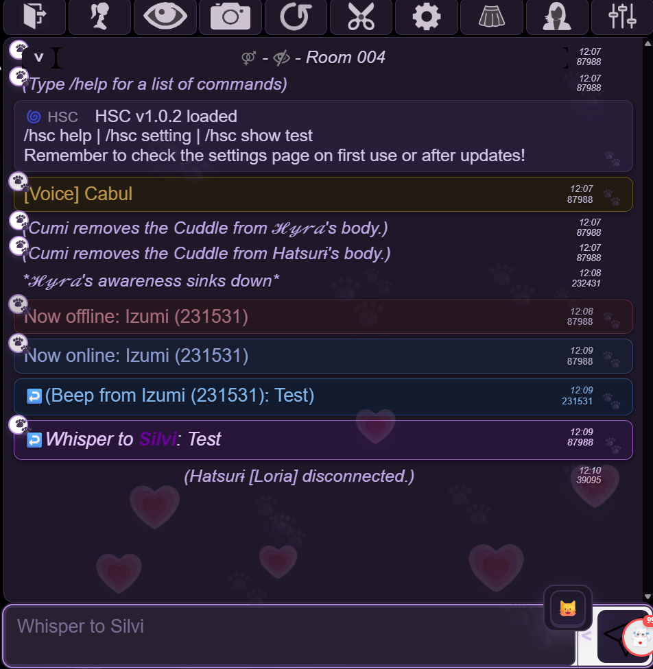
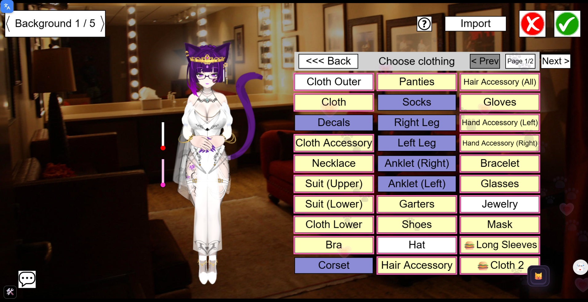
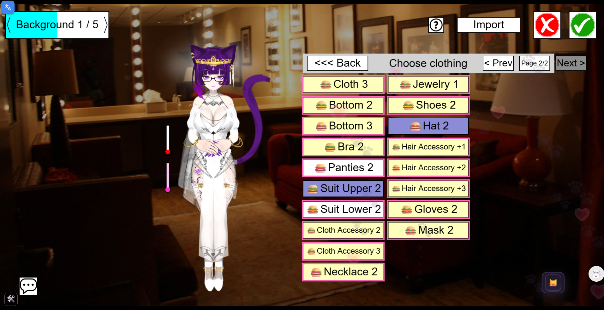
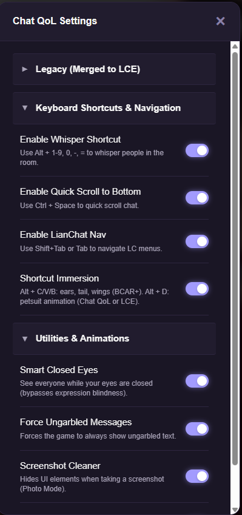
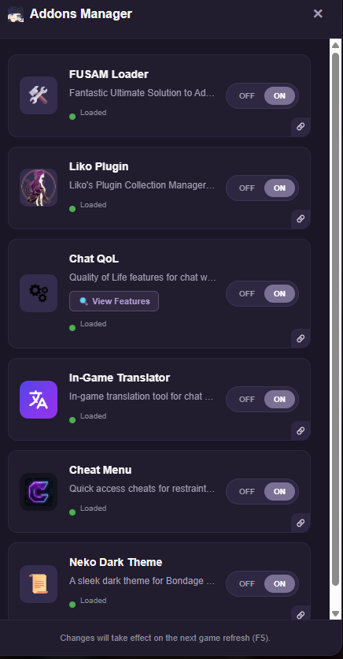
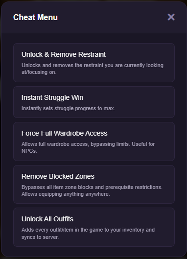

<div align="center">
  
  <h1>BC Desktop</h1>
  <p>Lightweight, native desktop client for BC</p>

  <p>
    <a href="https://github.com/Izumii99/BC-Desktop/releases"></a>
    <a href="https://github.com/Izumii99/BC-Desktop/releases"></a>
  </p>
  <p>
    
    
    
    
  </p>
</div>

---

A native desktop client for BC built with **WPF** and **.NET 8**. It uses the system webview (Edge WebView2 without bundled Chromium) to keep CPU and memory usage low.

---

<div align="center">
  <h3>☕ Support the Project / Traktir Kopi</h3>
  <p>Optional support for hosting and ongoing maintenance.</p>
  <p>
    <a href="https://sociabuzz.com/izumi99/tribe" target="_blank">
      <-48C02B?style=for-the-badge&logo=buymeacoffee&logoColor=white" height="36" alt="Treat Warm Coffee on SociaBuzz" />
    </a>
    &nbsp;
    <a href="https://sociabuzz.com/izumi99/support" target="_blank">
      
    </a>
  </p>
</div>

---

## Features

- **Auto-detects the latest game version** on every launch
- **OTA remote loader**: Fetches the addon manager and remote scripts directly on startup without manual downloads
- **Silent release checker**: Background check for newer desktop releases with title bar notifications
- **Borderless custom title bar** with window drag, minimize, maximize, and close
- **Immersive Fullscreen (F11)** and **Chromium DevTools (F12)** keyboard shortcuts
- **Sleeping tabs (suspend on minimize)** to reduce RAM while in the background
- **Multi-monitor support** with proper DPI scaling bounds
- **Discreet / stealth mode** support for Task Manager and Taskbar

> [!IMPORTANT]
> **Windows First-Launch Note (Unblock Binary):** If double-clicking `BC-Windows.exe` does nothing after downloading from a browser, Windows has attached a "Mark of the Web" security attribute. Right-click the `.exe` &rarr; **Properties** &rarr; check **Unblock** at the bottom of the General tab &rarr; click **Apply**.  
> **Global Server Note:** Bondage Club operates a single global game server for all regions (North America, Europe, and Asia play together in the same lobby and rooms). The client pins a single static CDN origin so your browser `localStorage` and `IndexedDB` addon configurations stay persistent across game updates.

## Adding Custom / Local Scripts Manually

You can load your own custom scripts or community mods offline without using Tampermonkey or bookmarklets by placing them in a local `Scripts/` directory.

### Folder Structure

Place the `Scripts` folder in the same root directory as the executable:

```text
📁 BC-Desktop/
├── 📁 Scripts/
│   ├── my-custom-addon.js
│   └── another-mod.js
└── BC.exe (or BC-Windows.exe / BC-Linux.AppImage)
```

## Included Scripts / Addons

This repository also hosts standalone scripts in the `Scripts/` folder. You can use them directly via Tampermonkey or Bookmarklets even without the Desktop App:

### 1. Neko Dark Mode (`neko-dark.js`)

A custom dark mode theme designed specifically for **Neko Chat Enhancer**.



**Design Highlights:**

- **Dark purple palette:** Replaces default high-contrast elements with dark purple surfaces.
- **Dimmed background overlay:** Lowers background particle opacity to keep chat text readable.
- **High-contrast chat text:** Adjusts whisper, action, and border colors for readability on dark backgrounds.

> [!TIP]
> **Built-in Loader:**  
> Powered by [QAQMOON/meow-](https://github.com/QAQMOON/meow-). Included with the desktop client and toggled through the Addon Manager without separate userscript installation.

**How to Install:**

#### Bookmarklet (One-Click)

```javascript
javascript:(()=>{var s=document.createElement("script");s.src="https://izumii99.github.io/BC-Desktop/Scripts/neko-dark.js?v="+Date.now();document.head.appendChild(s);})();
```

#### Tampermonkey, ViolentMonkey, etc. (Auto-Loader)

```javascript
// ==UserScript==
// @name         Neko Addons (Auto-Loader)
// @namespace    http://tampermonkey.net/
// @version      1.0
// @description  Neko Chat Enhancer dark mode
// @author       Izumii99
// @match        https://*.bondageprojects.elementfx.com/*
// @match        https://*.bondage-europe.com/*
// @match        https://*.bondageprojects.com/*
// @match        https://*.bondage-asia.com/*
// @grant        none
// ==/UserScript==

(function () {
    "use strict";
    var script = document.createElement("script");
    script.src =
        "https://izumii99.github.io/BC-Desktop/Scripts/neko-dark.js?v=" +
        Date.now();
    document.head.appendChild(script);
    console.log("Neko Addons Loader: Injected successfully!");
})();
```

### 2. Wardrobe & Appearance Pagination (`wardrobe-pagination.js`)

> [!NOTE]
> **Merged Upstream into BCX:**  
> Wardrobe pagination is now natively included in [Bondage Club Extended (BCX)](https://github.com/Jomshir98/bondage-club-extended). Standalone installation is no longer required when running current BCX versions.

Fixes the issue where having too many clothing items (e.g. from using multiple mods) causes the item list to overflow beyond the right side of the screen, making them impossible to click.

<p float="left">
  
  
</p>

_The standalone script has been officially retired as the pagination feature is now part of native BCX._

### 3. Chat QoL & Emoticons (`chat-qol.js`)

Maps text emoticons to character facial expressions and adds chat navigation shortcuts.



> [!NOTE]
> **Animation Modules Migrated:**  
> Petsuit and animal animations have been moved to [BC-LCE](https://github.com/awdrrawd/BC-LCE). Install BC-LCE to use those specific animation sets.

**Features:**

- **Text-to-Expression Emoticons:** Optional toggle that maps text emoticons like `:)`, `>:(`, `;p`, `><`, `=///=`, or `>3<` to your character's Eyes, Mouth, Eyebrows, Blush, and Tears automatically.
- **Floating Emoticons:** Using `!`, `?`, or `#` alongside an emoticon triggers the Exclamation, Confusion, or Annoyed floating icons above your character. Type `brb` or `afk` to display the BRB/AFK icon until you return.
- **Force Ungarbled Messages:** Keeps the "Show Ungarbled Messages" immersion setting active so you can read what others say through gags.
- **Persistent Hide Icon:** Remembers if you hid the chat room icon bar and keeps it hidden across reloads.
- **Persistent Room Customization:** Remembers your room customization (gear icon) ON/OFF state per room when rejoining or reconnecting.
- **Persistent Map View:** Keeps Map View restored automatically after reconnecting, relogging, or rejoining a room when you left it turned on.
- **Keyboard Shortcuts:**
    - `Ctrl + Space`: Scroll chat to bottom.
    - `Shift + Tab` / `Tab`: Navigate LianChat friends.
    - `Alt + Number (1-9)`: Whisper to characters in the room based on their position.

**How to Install:**

#### Bookmarklet (One-Click)

```javascript
javascript:(()=>{var s=document.createElement("script");s.src="https://izumii99.github.io/BC-Desktop/Scripts/chat-qol.js?v="+Date.now();document.head.appendChild(s);})();
```

#### Tampermonkey, ViolentMonkey, etc. (Auto-Loader)

```javascript
// ==UserScript==
// @name         Chat QoL & Emoticons (Auto-Loader)
// @namespace    http://tampermonkey.net/
// @version      1.0
// @description  Text-to-expression emoticons and chat shortcuts for Bondage Club
// @author       Izumii99
// @match        https://*.bondageprojects.elementfx.com/*
// @match        https://*.bondage-europe.com/*
// @match        https://*.bondageprojects.com/*
// @match        https://*.bondage-asia.com/*
// @grant        none
// ==/UserScript==

(function () {
    "use strict";
    var script = document.createElement("script");
    script.src =
        "https://izumii99.github.io/BC-Desktop/Scripts/chat-qol.js?v=" +
        Date.now();
    document.head.appendChild(script);
    console.log("Chat QoL Loader: Injected successfully!");
})();
```

### 4. Addon Manager UI (`addon-manager.js`)

In-game interface to toggle client addons, supported community loaders, and custom bookmarklets.



**Features:**

- Floating quick-access button inside the game (available on the login screen, chat rooms, and profile).
- One-click toggles for built-in scripts and external loaders (FUSAM, Liko Plugin) without managing separate userscripts.
- **Bookmarklet & Custom Script Runner:** Paste any `javascript:` bookmarklet or custom JS snippet into the input bar to run it directly inside the game. Includes a saved history cache for one-click re-runs, optional startup auto-run per entry, and an execution status pop-up showing whether the script ran or failed.
- Automatically fetches the latest script updates from the repository.

**How to Install:**

#### Bookmarklet (One-Click)

```javascript
javascript:(()=>{var s=document.createElement("script");s.src="https://izumii99.github.io/BC-Desktop/Scripts/addon-manager.js?v="+Date.now();document.head.appendChild(s);})();
```

#### Tampermonkey, ViolentMonkey, etc. (Auto-Loader)

```javascript
// ==UserScript==
// @name         BC Desktop Addon Manager
// @namespace    http://tampermonkey.net/
// @version      1.0
// @description  Manages BC Desktop addons with a built-in UI
// @author       Izumii99
// @match        https://*.bondageprojects.elementfx.com/*
// @match        https://*.bondage-europe.com/*
// @match        https://*.bondageprojects.com/*
// @match        https://*.bondage-asia.com/*
// @grant        none
// ==/UserScript==

(function () {
    "use strict";
    var script = document.createElement("script");
    script.src =
        "https://izumii99.github.io/BC-Desktop/Scripts/addon-manager.js?v=" +
        Date.now();
    document.head.appendChild(script);
    console.log("Addon Manager Loader: Injected successfully!");
})();
```

### 5. Cheat Menu (`cheat-menu.js`)

Floating draggable overlay providing testing shortcuts and restraint/wardrobe utility toggles.



**Features:**

- **Instant Struggle Win:** Sets struggle minigame progress directly to completion.
- **Remove Blocked Zones:** Bypasses item zone blocks and prerequisite restrictions when testing outfits or items.
- **Toggle Auto Mirror Restraints:** Automatically removes restraints placed on you and mirrors them back onto the sender.
- **Unlock & Remove Restraint:** Quickly unlocks and strips active restraints during testing.
- **Unlock All Outfits:** Unlocks wardrobe and inventory items locally for previewing and testing.

**How to Install:**

#### Bookmarklet (One-Click)

```javascript
javascript:(()=>{var s=document.createElement("script");s.src="https://izumii99.github.io/BC-Desktop/Scripts/cheat-menu.js?v="+Date.now();document.head.appendChild(s);})();
```

#### Tampermonkey, ViolentMonkey, etc. (Auto-Loader)

```javascript
// ==UserScript==
// @name         Cheat Menu
// @namespace    http://tampermonkey.net/
// @version      1.0
// @description  A lightweight floating cheat menu for Bondage Club
// @author       Izumii99
// @match        https://*.bondageprojects.elementfx.com/*
// @match        https://*.bondage-europe.com/*
// @match        https://*.bondageprojects.com/*
// @match        https://*.bondage-asia.com/*
// @grant        none
// ==/UserScript==

(function () {
    "use strict";
    var script = document.createElement("script");
    script.src =
        "https://izumii99.github.io/BC-Desktop/Scripts/cheat-menu.js?v=" +
        Date.now();
    document.head.appendChild(script);
    console.log("Cheat Menu Loader: Injected successfully!");
})();
```

### 6. In-Game Translator (`translate.js`)

Floating Shadow DOM translation widget for translating chat messages in real time without leaving the room.

**Features:**

- Floating toggle button in the top-left corner with a compact pop-up panel isolated in Shadow DOM so external themes never break its styling.
- Supports quick language switching, automatic source detection, and one-click copy of translated output directly into chat.

**How to Install:**

#### Bookmarklet (One-Click)

```javascript
javascript:(()=>{var s=document.createElement("script");s.src="https://izumii99.github.io/BC-Desktop/Scripts/translate.js?v="+Date.now();document.head.appendChild(s);})();
```

#### Tampermonkey, ViolentMonkey, etc. (Auto-Loader)

```javascript
// ==UserScript==
// @name         In-Game Translator (Auto-Loader)
// @namespace    http://tampermonkey.net/
// @version      1.0
// @description  Floating real-time translation widget for Bondage Club
// @author       Izumii99
// @match        https://*.bondageprojects.elementfx.com/*
// @match        https://*.bondage-europe.com/*
// @match        https://*.bondageprojects.com/*
// @match        https://*.bondage-asia.com/*
// @grant        none
// ==/UserScript==

(function () {
    "use strict";
    var script = document.createElement("script");
    script.src =
        "https://izumii99.github.io/BC-Desktop/Scripts/translate.js?v=" +
        Date.now();
    document.head.appendChild(script);
    console.log("In-Game Translator Loader: Injected successfully!");
})();
```

## Performance & Resource Benchmarks

| Metric                          | Standard Web Browser  | BC Desktop Client                        |
| ------------------------------- | --------------------- | ---------------------------------------- |
| **Engine Architecture**         | General Web Browser   | Tuned Game Runtime (WebView2 / Electron) |
| **CPU (Active Focus / On Tab)** | ~15% – 30%+           | ~6% – 12% (Active 60 FPS Pacer)          |
| **CPU (Background / Tab Out)**  | ~8% – 15%             | ~3% – 5% (15 FPS Background Throttle)    |
| **GPU (Active Focus / On Tab)** | ~12% – 25%            | ~6% – 12% (Hardware 2D Canvas)           |
| **GPU (Background / Tab Out)**  | ~4% – 10%             | < 1% (Low-Power GPU Idle State)          |
| **RAM (Active, 40+ Addons)**    | ~1,000 MB – 1,800 MB+ | ~600 MB – 1,000 MB                       |
| **RAM (Background / Tab Out)**  | ~800 MB – 1,400 MB    | ~200 MB – 500 MB (Sleeping Tabs & Trim)  |

_Note: The resource usage above was benchmarked under heavy load (running the game with a total of **40+ addons**, including more than 10 major/heavy addons like BCX, Liko, FUSAM, and Chat-QoL). Vanilla usage without addons will be significantly lower._

## Requirements

- **Windows:** Windows 10/11 with Edge WebView2 (pre-installed on modern Windows)
- **Linux:** Any modern 64-bit distribution (Ubuntu, Debian, Fedora, Arch, SteamOS)

## Building from Source

Prerequisites: [.NET 8 SDK](https://dotnet.microsoft.com/en-us/download/dotnet/8.0) and [Node.js](https://nodejs.org/)

```powershell
git clone https://github.com/Izumii99/BC-Desktop.git
cd BC-Desktop
dotnet restore
dotnet build -c Release
```

## Running Tests

To run the automated unit test suite locally:

```powershell
dotnet test
```

## Packaging Standalone Binaries

**Build Everything (Windows & Linux):**

```powershell
.\tools\build_all.ps1
```

**Build Windows Standalone Only:**

```powershell
.\tools\local_window.ps1
```

**Build Linux Packages Only (.AppImage & .tar.gz):**

```powershell
.\tools\local_linux.ps1
```

## Project Structure

```text
BC-Desktop/
├── .github/
│   └── workflows/
│       ├── checks.yml                : Automated unit test & CI verification
│       └── release.yml               : Multi-platform binary compile & release
├── Assets/
│   ├── app.ico / app_logo.png        : Official client branding & icons
│   └── transparent.ico / .png        : Discreet stealth mode assets
├── Scripts/                          : Central upstream addon repository
│   ├── addon-manager.js              : In-game mod manager & bookmarklet runner
│   ├── chat-qol.js                   : Emoticons, Map View/gear persistence & shortcuts
│   ├── cheat-menu.js                 : Struggle, restraint & wardrobe testing utilities
│   ├── neko-dark.js                  : Dark purple theme stylesheet & assets
│   └── translate.js                  : Real-time floating translation widget
├── platform/linux/                   : Linux portable wrapper (Electron)
│   ├── main.js                       : Window lifecycle & auto-recovery engine
│   ├── build.js                      : AppImage & tarball builder
│   └── package.json                  : Linux dependencies & metadata
├── tests/
│   └── BCDesktop.Tests/              : Automated MSTest suite (35 unit tests)
│       └── MainWindowTests.cs        : Aspect ratio, SemVer, R134 & memory tests
├── tools/                            : PowerShell build toolchain
│   ├── build_all.ps1                 : Unified multi-platform release builder
│   ├── local_window.ps1              : Local Windows compilation
│   ├── local_linux.ps1               : Local Linux compilation
│   └── local_tester.ps1              : Rapid internal dev testing runner
├── App.xaml / App.xaml.cs            : Application entry point
├── BC-Desktop.csproj                 : .NET 8 WPF project configuration & metadata
├── BC-Desktop.sln                    : Visual Studio solution file
├── MainWindow.xaml                   : Borderless custom window & title bar UI
├── MainWindow.xaml.cs                : Core WebView2 bootstrap & window host
├── MainWindow.Events.cs              : Window focus, minimize & input lifecycle
├── MainWindow.Interop.cs             : Win32 DPI, borderless maximize & taskbar P/Invoke
├── MainWindow.Scripts.cs             : Injected focus, VRAM & R134 stability hooks
├── MainWindow.Updates.cs             : Live version detector, instant updater & changelog
├── loader.user.js                    : Standalone userscript & embedded offline loader
└── RELEASE_NOTES.md                  : User-facing changelog & release details
```
